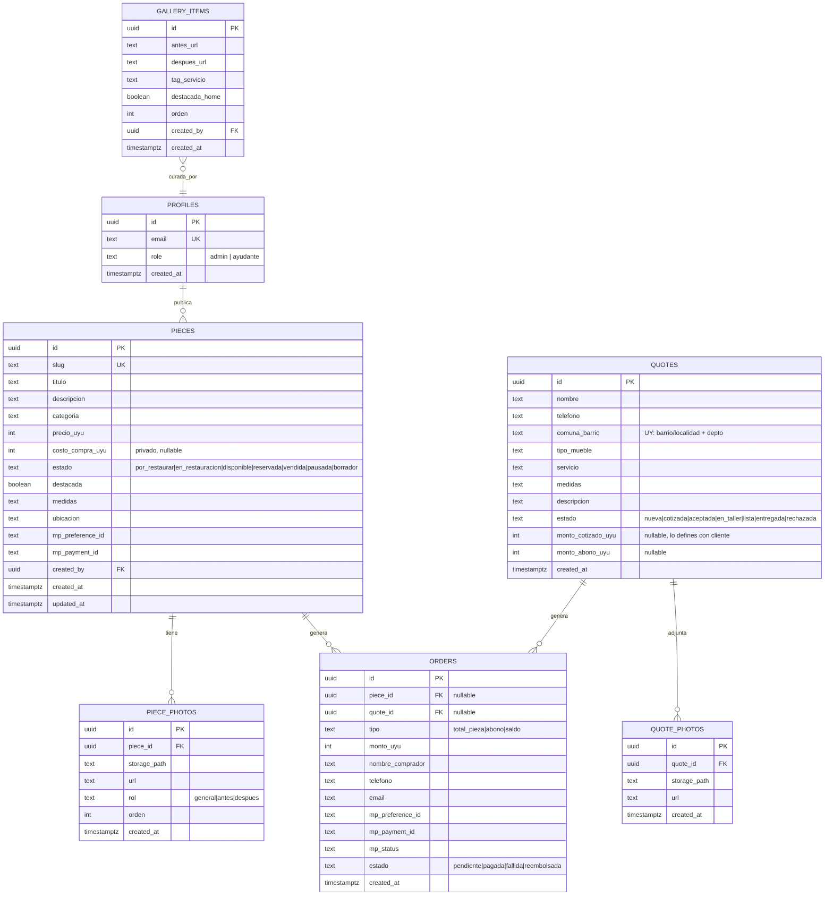

# 10 — Modelo Relacional (planteado, sin migrar aún)

> Estado: **propuesta lógica**. No hay migraciones SQL aplicadas todavía. Cuando definas precios con el cliente y confirmemos categorías, lo paso a migraciones Supabase.
> Todo Uruguay: moneda **UYU** (pesos uruguayos, enteros, sin decimales), dominio **.uy**, logística **DAC / Correo Uruguayo / flete propio / retiro**.

## 1. Diagrama (lógica)

## 2. Por qué tabla de fotos separada (y no array)
- Reordenar (portada primero) sin reescribir arrays.
- Marcar rol `antes/después` para el slider.
- Borrar 1 foto sin tocar las demás.
- A futuro: alt SEO por foto.
- Si quieres partir ultra-simple, se puede usar `fotos text[]` en `pieces`, pero recomiendo tabla separada desde el día 1 (cuesta lo mismo).

## 3. Reglas de estado
- `pieces`: `por_restaurar → en_restauracion → disponible → reservada → vendida`. `pausada/borrador` son laterales (no visibles).
  - Solo `disponible` es visible en `/piezas` pública.
  - Pasar a `disponible` exige: precio_uyu > 0 + ≥1 foto rol general.
  - Webhook MP `pagada` tipo `total_pieza` → `vendida` automático.
- `quotes`: `nueva → cotizada → aceptada → en_taller → lista → entregada`. `rechazada` lateral.
  - Orden `abono` pagada → quote `aceptada`. Orden `saldo` pagada → `entregada` (o `lista` según entrega física).
- `orders` nunca se borra (trazabilidad dinero). Solo cambia `estado`.

## 4. Índices recomendados (para cuando migremos)
- `pieces(estado)`, `pieces(slug)`, `pieces(destacada)` parcial donde disponible.
- `piece_photos(piece_id, orden)`, `quote_photos(quote_id)`.
- `quotes(estado, created_at desc)`, `orders(estado, created_at desc)`, `orders(mp_payment_id)` único parcial.
- `gallery_items(destacada_home, orden)`.

## 5. RLS (resumen, SQL en migración después)
- `pieces`: SELECT público solo `estado='disponible'` (+ join fotos). INSERT/UPDATE/DELETE solo admin.
- `piece_photos`: SELECT público solo si su pieza está disponible; escritura solo admin.
- `quotes` / `quote_photos`: público solo INSERT (formulario), sin SELECT. Lectura/update solo admin.
- `orders`: sin acceso público directo (se crean vía API server). Lectura solo admin.
- `gallery_items`: SELECT público; escritura admin.
- Storage buckets `piezas/`, `cotizaciones/`, `galeria/`: lectura pública, escritura admin (cotizaciones: upload vía endpoint firmado, no directo).

## 6. Ejemplos de consulta (para el dashboard)
- Disponibles + valor stock: `select count(*), sum(precio_uyu) from pieces where estado='disponible'`.
- Kanban taller: `select * from pieces where estado in ('por_restaurar','en_restauracion') order by updated_at`.
- Cotizaciones sin responder >24h: `select * from quotes where estado='nueva' and created_at < now() - interval '24 hours'`.
- Reservadas colgadas: `select p.* from pieces p join orders o on o.piece_id=p.id where p.estado='reservada' and o.estado='pendiente' and o.created_at < now() - interval '48 hours'`.

## 7. Pendientes que define el cliente (no asumir)
- [ ] Categorías fijas (ej: silla, mesa, cómoda, ropero, reloj, cuadro, lámpara…)
- [ ] Precios: solo estructura lista, valores los pones tú con él.
- [ ] Comuna/barrio: ¿Montevideo + interior? ¿costo flete por depto?
- [ ] Términos/devoluciones: los redactan con él (obligatorio para publicar pagos).
